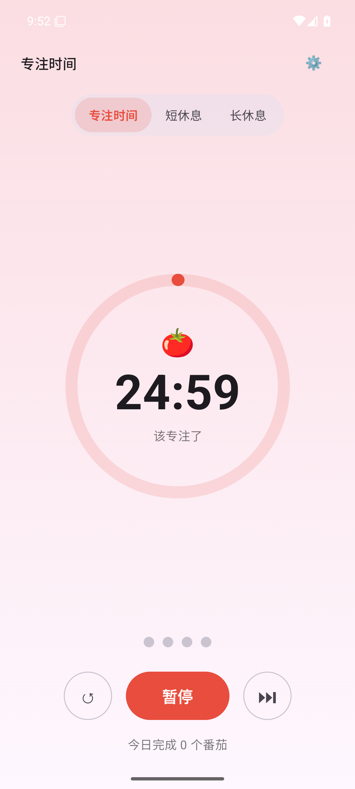

# 🍅 番茄时钟（Pomodoro Android）

原生 **Kotlin + Jetpack Compose** 番茄工作法应用，与同仓库的 [web 版](../pomodoro-web/)、[iOS 版](../pomodoro-ios/) 共享同一套"纯逻辑状态机 + 时间注入"核心架构。



## 功能

- **三种模式**：专注 / 短休息 / 长休息，默认 25 / 5 / 15 分钟，设置可调（带范围收敛）
- **自动循环**：专注结束自动进入休息（可关）；每完成 4 个番茄一次长休息（间隔 1–12 可改）
- **控制**：开始 / 暂停 / 重置 / 跳过（跳过不计入统计）+ 阶段切换
- **可视化**：环形倒计时（Canvas 绘制）、周期圆点、阶段主题色（红/绿/蓝渐变）
- **提醒**：ToneGenerator 合成提示音（专注/休息两种音型，无音频文件）+ 本地通知（权限被拒自动降级）
- **持久化**：SharedPreferences JSON；回到应用时结算「离开期间已结束」的阶段并暂停待确认

## 架构

```
pomodoro-android/
├── app/src/main/java/com/mico/pomodoro/
│   ├── MainActivity.kt              # Compose 入口
│   ├── core/PomodoroCore.kt        # ⭐ 纯逻辑状态机：时间由参数注入，可确定性单测
│   ├── ui/PomodoroViewModel.kt     # 协程 250ms tick 只驱动 UI；状态以时间戳结算不漂移
│   ├── ui/TimerScreen.kt           # 主界面：阶段选择、圆环、大数字、控制按钮、设置弹窗
│   └── service/Feedback.kt         # 提示音 + 通知（静默降级）
├── app/src/test/.../PomodoroCoreTests.kt   # 18 个 JUnit：快进场景确定性测试
└── keystore/debug.keystore          # 本地 debug 签名（沙箱环境无法写 ~/.android）
```

核心设计（三端同构）：

- **纯逻辑状态机**：`PomodoroCore` 不依赖 Android 框架、不取真实时钟，`tick(state, now)` 由调用方注入时间——单测可"快进 26 分钟"而无需真实等待
- **时间戳结算**：运行中只保存 `endsAt`，暂停冻结剩余、恢复重算终点——后台/锁屏/切前台不累计漂移
- **设置归一化**：时长收敛到合法范围（1–180 / 1–60 / 1–120 / 1–12），非法输入不破坏计时器

## 构建与运行

```bash
cd pomodoro-android
./gradlew assembleDebug          # 构建 APK
./gradlew testDebugUnitTest      # 18 个单元测试（纯 JVM）

# 安装到已启动的模拟器/设备
$ANDROID_HOME/platform-tools/adb install -r app/build/outputs/apk/debug/app-debug.apk
$ANDROID_HOME/platform-tools/adb shell am start -n com.mico.pomodoro/.MainActivity
```

在 Android Studio 中打开项目根目录即可直接 Run。

## 测试（18/18 通过）

覆盖路径：初始状态、设置归一化（越界/回退）、开始/暂停冻结/恢复不漂移、剩余为 0 拒绝开始、专注结束自动进入短休息、第 4 个番茄进长休息、休息结束回专注、关闭自动开始、跳过不计数、重置、周期圆点、时间格式化、运行中恢复、离开期间到期→结算并暂停、损坏数据回退。

## 模拟器实测（本机验证）

- ✅ `assembleDebug` 构建成功（AGP 8.13.2 / Kotlin 2.4.0 / Compose BOM 2025.10.01）
- ✅ 18/18 JVM 单元测试通过
- ✅ Pixel 6 AVD（API 35 / arm64）headless 启动，`adb install` 成功
- ✅ 应用启动无崩溃；uiautomator 确认完整 UI 树（阶段选择/倒计时/控制按钮/统计）
- ✅ 点击「开始」→ 按钮变「暂停」、倒计时数字持续变化、SharedPreferences 持久化正确
- ✅ force-stop 重启后剩余时间正确恢复（24:20 而非重置 25:00）
- ✅ 注入过期运行状态 → 重启后正确结算：进入短休息暂停态、番茄计数 +1

## 环境备注

- 本沙箱环境限制 `~/.android`、`~/.gradle` 写入：debug keystore 置于 `keystore/`，Gradle 用户目录经 `GRADLE_USER_HOME` 重定向
- SDK/镜像/AVD 位于 `../android-tools/`（系统镜像 API 35 google_apis arm64-v8a，约 3.8GB，不入库）
