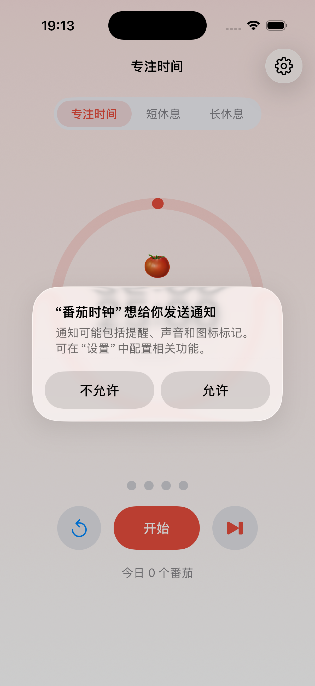

# 🍅 番茄时钟（Pomodoro iOS）

原生 **SwiftUI** 番茄工作法应用：专注 25 分钟 → 短休息 5 分钟，每完成 4 个番茄进入长休息。功能设计对齐同工作区的 `pomodoro-web`（网页版），核心状态机为同一套"纯逻辑 + 时间注入"架构的 Swift 移植。



## 快速开始

```bash
export DEVELOPER_DIR=/Applications/Xcode.app/Contents/Developer

# 构建（iPhone 17 Pro / iOS 26.5 模拟器）
cd pomodoro-ios
xcodebuild -project Pomodoro.xcodeproj -scheme Pomodoro \
  -destination 'platform=iOS Simulator,name=iPhone 17 Pro' \
  -derivedDataPath build CODE_SIGNING_ALLOWED=NO build

# 安装并启动（模拟器需已 boot：xcrun simctl boot <UDID>）
UDID=$(xcrun simctl list devices available | grep "iPhone 17 Pro (" | awk -F'[()]' '{print $4}' | head -1 | tr -d ' ')
xcrun simctl install "$UDID" build/Build/Products/Debug-iphonesimulator/Pomodoro.app
xcrun simctl launch "$UDID" com.mico.pomodoro
```

也可以直接双击 `Pomodoro.xcodeproj` 用 Xcode 打开，选 iPhone 模拟器后 Cmd+R 运行。

## 功能

| 能力 | 说明 |
| --- | --- |
| 三种模式 | 专注 / 短休息 / 长休息，默认 25 / 5 / 15 分钟，设置页可调 |
| 自动循环 | 专注结束自动开始休息（可关）；长休息间隔默认 4 个番茄（1–12 可改） |
| 控制 | 开始 / 暂停 / 重置 / 跳过；跳过不计入统计 |
| 可视化 | 环形倒计时（按真实时间推进）、周期圆点、阶段主题色（红/绿/蓝渐变背景） |
| 提醒 | 系统提示音（专注/休息两种音型）+ 本地通知（权限被拒自动降级） |
| 记忆 | 设置、今日番茄数、周期进度、未完成的计时都存 UserDefaults |
| 恢复结算 | 回到 app 时若计时已结束：只结算这一个阶段并暂停等待确认，不连锁自动接续 |

## 架构

```
pomodoro-ios/
├── Pomodoro.xcodeproj/          # 手写 objectVersion 70 工程（fileSystemSynchronizedGroups，加文件无需登记）
├── Pomodoro/
│   ├── PomodoroApp.swift        # App 入口（NavigationStack）
│   ├── Core/PomodoroCore.swift  # ⭐ 纯逻辑状态机：时间全部由参数注入，可确定性单测
│   ├── ViewModels/PomodoroViewModel.swift  # @MainActor；Timer 只驱动 UI 刷新，状态以时间戳结算
│   ├── Views/TimerView.swift    # 主界面：阶段选择、圆环、大数字、控制按钮、周期圆点
│   ├── Views/SettingsView.swift # 设置页：时长/间隔/自动化/提醒/恢复默认/清零统计
│   ├── Services/SoundService.swift        # AudioServices 系统音（无音频文件）
│   └── Services/NotificationService.swift # UNUserNotificationCenter 本地通知
├── PomodoroTests/
│   └── PomodoroCoreTests.swift  # 19 个 XCTest：快进场景确定性测试
└── screenshots/focus-idle.png   # 模拟器实机截图
```

核心设计（继承自 web 版 `timer-core.js`）：

- **纯逻辑状态机**：`PomodoroCore` 不依赖 UI、不取真实时钟，`tick(state, at: now)` 由调用方注入时间——单测可以"快进 26 分钟"而不必真实等待。
- **时间戳结算**：运行中只保存 `endsAt`，每 0.25s 的 UI tick 用真实时钟重算剩余；暂停冻结剩余时长、恢复时以 `now + 剩余` 重算终点——后台/锁屏/切前台都不累计漂移。
- **设置归一化**：所有时长经 `normalize` 收敛到合法范围（专注 1–180、短休 1–60、长休 1–120、间隔 1–12），非法输入不会破坏计时器。

## 测试

```bash
export DEVELOPER_DIR=/Applications/Xcode.app/Contents/Developer

# 标准方式（需要宿主进程可 forkpty；本沙箱环境不可用时见下方替代）
xcodebuild -project Pomodoro.xcodeproj -scheme Pomodoro \
  -destination 'platform=iOS Simulator,name=iPhone 17 Pro' \
  -derivedDataPath build CODE_SIGNING_ALLOWED=NO test

# 沙箱替代方案：直接在模拟器上下文跑 xctest（本机已验证 19/19 通过）
UDID=384EA5DF-8A23-40A9-B169-F8ECFD772CA1   # iPhone 17 Pro
APP=build/Build/Products/Debug-iphonesimulator/Pomodoro.app
cp $APP/Pomodoro.debug.dylib $APP/PlugIns/PomodoroTests.xctest/Frameworks/ 2>/dev/null || {
  mkdir -p $APP/PlugIns/PomodoroTests.xctest/Frameworks
  cp $APP/Pomodoro.debug.dylib $APP/PlugIns/PomodoroTests.xctest/Frameworks/
}
xcrun simctl spawn $UDID \
  /Applications/Xcode.app/Contents/Developer/Platforms/iPhoneSimulator.platform/Developer/Library/Xcode/Agents/xctest \
  $PWD/$APP/PlugIns/PomodoroTests.xctest
```

覆盖的关键路径：初始状态、设置归一化（越界收敛、nil 回退）、开始/暂停剩余冻结/恢复不漂移、剩余为 0 拒绝开始、专注结束自动进入短休息、第 4 个番茄进入长休息、休息结束回专注（默认不自动开始）、关闭自动开始后的行为、跳过不计入统计、重置回满时长、周期圆点映射、时间格式化、Codable 往返序列化、运行中恢复、离开期间结束→结算并暂停、损坏数据回退初始。

## 已验证（本机实测）

- ✅ `xcodebuild build` 零错误（iOS 26.5 模拟器 SDK，arm64 + x86_64）
- ✅ 19/19 单元测试通过（模拟器实跑）
- ✅ `simctl install` + `launch` 正常启动，无崩溃日志
- ✅ 截图确认专注阶段红色主题 UI 正常渲染（1206×2622）
- ✅ UserDefaults 持久化内容正确（初始 focus/1500s/静止）
- ✅ 端到端观测到「写入过期运行状态 → 恢复时结算专注完成 → 进入短休息并暂停」的恢复逻辑

## 环境备注

- Xcode 26.6（`/Applications/Xcode.app`），命令行工具需 `DEVELOPER_DIR` 指向 Xcode（系统默认只有 CommandLineTools）
- 本沙箱环境下 `AssetCatalogSimulatorAgent` 无法 spawn（CoreSimulator Caches 写入被拦截），因此没有使用 `Assets.xcassets`；App 图标以 `Resources/AppIcon.png` 直接打包（fileSystemSynchronizedGroups 自动收录）
- 模拟器构建无需签名（`CODE_SIGNING_ALLOWED=NO`）；真机部署需在 Xcode 中配置个人签名
