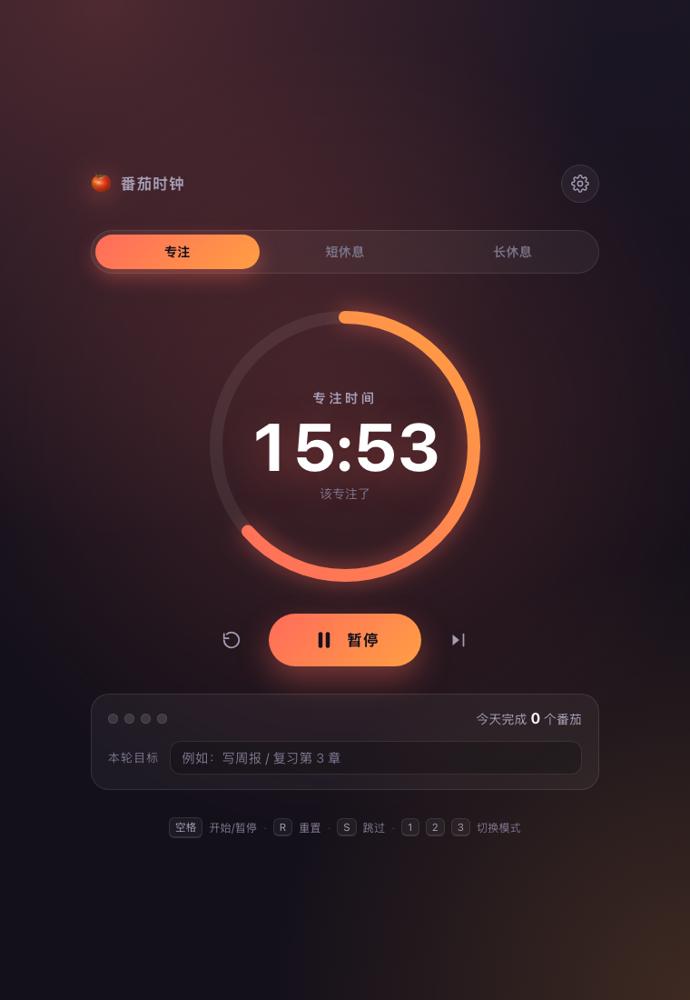

# 🍅 番茄时钟（Pomodoro Web）

一个**零依赖、纯前端、可离线**的番茄工作法计时器：专注 25 分钟 → 短休息 5 分钟，每完成 4 个番茄进入一次长休息。不联网、不追踪、数据只留在你自己的浏览器里。



## 快速开始

**推荐：直接打开单文件版**（所有 CSS/JS 已内联，双击即用，也可以直接发给别人或放进沙箱预览器）：

```bash
open pomodoro.html        # 单文件版，50KB，零外部依赖
```

也可以跑多文件版（便于改代码）：

```bash
# 起一个本地静态服务（Chrome 在 file:// 下会限制 localStorage 与通知权限）
node tools/serve.mjs        # 或 npm start → http://127.0.0.1:4321/
```

> 没有任何构建步骤、没有 npm 依赖、没有后端。改完 `styles.css` / `timer-core.js` / `app.js` 后执行
> `npm run build` 重新生成 `pomodoro.html` 即可（`npm run test:browser` 会自动先构建）。

### 为什么有两个版本

有些预览器 / 阅读器（例如带沙箱的 Markdown、文档预览面板）出于安全策略**禁止页面加载同目录的外部资源**，
这时多文件版会退化成"没有样式的裸 HTML"（连 SVG 圆环都会按默认黑色填充画成一个大黑圆）。
单文件版把三个资源全部内联，不存在这个问题。两者由同一套源码生成、跑同一套断言，行为完全一致。

## 功能

| 能力 | 说明 |
| --- | --- |
| 三种模式 | 专注 / 短休息 / 长休息，默认 25 / 5 / 15 分钟，可自行调整 |
| 自动循环 | 专注结束自动开始休息（可关）；长休息间隔默认 4 个番茄（可改） |
| 可视化 | SVG 环形倒计时（按真实时间推进，切换标签页不会走偏）、周期圆点、阶段主题色 |
| 控制 | 开始 / 暂停 / 重置 / 跳过，全部支持键盘：`空格`、`R`、`S`、`1` `2` `3`、`Esc` |
| 提醒 | Web Audio 合成提示音（专注/休息两个音型）+ 可选桌面通知，无任何外部音频文件 |
| 记忆 | 设置、今日番茄数、周期进度、未完成的计时（含「关页面期间已结束」的结算）都存 `localStorage` |
| 细节 | 标签页标题实时倒计时、本轮目标输入框、无障碍标签与焦点管理、`prefers-reduced-motion`、移动端适配 |

## 文件结构

```
pomodoro-web/
├── pomodoro.html         # ⭐ 单文件版（构建产物，内联全部 CSS/JS，可直接分发）
├── index.html            # 多文件版页面结构（含内联 SVG favicon，无外部资源）
├── styles.css            # 主题与布局，阶段配色由 body[data-phase] 驱动
├── timer-core.js         # 纯逻辑状态机（无 DOM，可在 Node 中单测）
├── app.js                # DOM 渲染、事件绑定、音效/通知/存储
├── tests/
│   └── timer-core.test.js    # 17 个单元测试（node:test，零依赖）
├── tools/
│   ├── build-single.mjs      # 构建单文件版：内联 CSS/JS → pomodoro.html
│   ├── selftest.html         # 浏览器内自检页：iframe 加载真实页面并驱动交互
│   ├── run-selftest.mjs      # 用无头 Chrome 跑自检并解析报告
│   └── serve.mjs             # 本地静态服务器
└── screenshots/              # 由自检脚本生成的状态截图
```

架构上刻意把**时间逻辑**（`timer-core.js`）与**界面**（`app.js`）分开：核心是纯函数状态机，时间通过参数传入而不是到处调 `Date.now()`，所以可以完全确定性地测试「快进 26 分钟」这类场景，不必真的等 25 分钟。

## 测试

```bash
npm test              # 17 个核心逻辑单元测试（node:test，不需要浏览器）
npm run test:browser  # 128 项浏览器端到端断言（多文件版 + 单文件版各 64 项，需要本机有 Chrome）
npm run test:all      # 两者都跑
npm run test:screenshots   # 顺便把各状态截图写到 screenshots/
```

`npm run test:browser` 会起一个临时静态服务器、用无头 Chrome 打开 `tools/selftest.html`，由页面自己在 iframe 里点击按钮 / 按键 / 改设置，最后把断言报告写进 DOM 再取回解析。它也能直接在浏览器里打开看结果：

```
http://127.0.0.1:4321/tools/selftest.html
```

覆盖的关键路径：初始状态、开始/暂停与剩余时间冻结、专注结束自动进入休息、跳过不计入统计、数字键切换模式、设置面板回填与越界收敛、设置持久化、刷新后恢复、关闭自动开始后的行为、长休息规则（第 4 个番茄）、恢复默认、统计清零、控制台无未捕获异常。

自检过程中真实修复了两个只在浏览器里才暴露的问题：

1. `stroke-dashoffset` 行内写入无单位数值会被浏览器忽略 → 进度环永远不动，必须写 `px`；
2. 面板/提示的入场动画依赖 `requestAnimationFrame`，在 rAF 被节流的场景下不会加上 `is-open` → 改为强制重排触发过渡。

## 设计取舍

- **rAF + 定时器双保险**：`requestAnimationFrame` 负责圆环的顺滑动画，同时每 500ms 的定时器兜底推进并在后台标签页被节流时也能刷新界面；两者都只是调用同一个 `tick`，状态以真实时间戳结算，所以不会累计漂移。
- **不引入任何依赖**：没有构建、没有字体/图标/音频外链，断网可用，便于长期存放。
- **暂停不丢失**：暂停时冻结剩余毫秒数，恢复时以「现在 + 剩余」重算终点，暂停多久都不影响。

## 浏览器支持

Chrome / Edge / Safari / Firefox 近两年的版本。桌面通知需要 https 或 `localhost`（`file://` 下浏览器会拒绝授权，应用会降级为只播放提示音并给出提示）。
